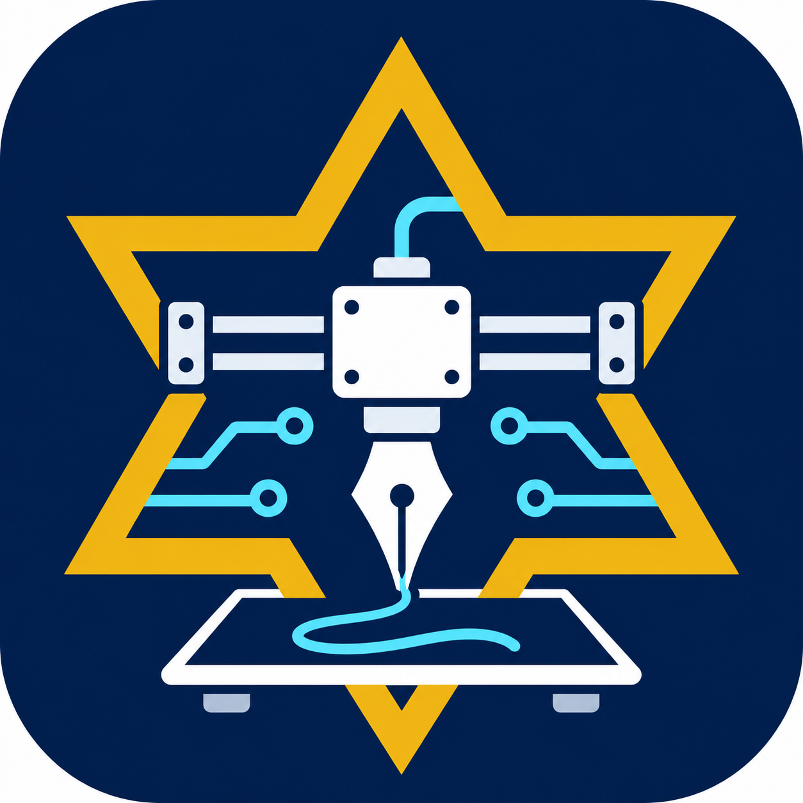

<p align="center">
  
</p>
<h1 align="center">Neiroslopper</h1>
<p align="center"><strong>Windows-пульт для CNC-плоттера на FluidNC</strong><br>От эскиза на экране — к линиям на бумаге.</p>
<p align="center">
  <a href="https://github.com/PetyaBlinov/Neiroslopper/actions/workflows/tests.yml"></a>
  
  
  
  
</p>
<p align="center">
  <a href="#быстрый-старт">Запуск</a> ·
  <a href="docs/hardware-status.md">Подключение платы</a> ·
  <a href="docs/architecture.md">Как устроено</a> ·
  <a href="CONTRIBUTING.md">Работа с кодом</a>
</p>

Neiroslopper помогает подготовить рисунок, проверить траекторию и отправить её на плоттер. Приложение работает с официальной **FluidNC** на **Makerbase MKS DLC32 v2.2**, поддерживает USB и Wi-Fi и открывается отдельным окном Windows.

Движением двигателей занимается FluidNC. Пульт отвечает за рисунок, координаты листа, последовательную отправку команд и состояние задания.

## Возможности

- **Редактор без оборудования:** эскиз A4, русский и латинский текст, фигуры, проекты, отмена и повтор.
- **SVG и предпросмотр:** линии рисунка и переходы между штрихами видны до запуска.
- **Лист по двум углам:** ручная установка верхнего левого и нижнего правого углов.
- **Управление плоттером:** шаговые перемещения, скорость, тестовый квадрат, СТОП и Esc.
- **Подъём ручки:** реле/соленоид через M8/M9 с проверкой фактического выхода и полярности.
- **DEMO:** весь основной процесс можно попробовать с виртуальным станком.
- **Проект конфигурации:** мастер экспортирует YAML из введённых параметров платы.

Камера, обработка растров и старый DWIN-интерфейс сохранены как дополнительные модули. Их подключение описано в [инструкции](README_RU.md). ИИ и голосовой ввод в текущую версию не входят.

## Быстрый старт

Нужен **Windows, Python 3.11–3.14 x64 и Tkinter**. При установке Python оставьте компонент Tcl/Tk.

1. Скачайте или клонируйте репозиторий в обычную папку.
2. Один раз запустите `INSTALL.cmd`.
3. Открывайте пульт через `START.cmd`.

Из PowerShell:

```powershell
.\INSTALL.cmd
.\START.cmd
```

Установщик создаёт локальную `.venv` и устанавливает базовые зависимости. Если в локальной копии есть `vendor/wheels`, используются эти файлы; обычный GitHub-клон загружает зависимости через pip.

При запуске выбран **DEMO**. Приложение само не подключается к плате и не включает выходы. Редактор и эскиз A4 доступны сразу.

### Первое знакомство

1. Оставьте DEMO и нажмите **«Подключить»**.
2. Попробуйте перемещение и сохраните два угла листа.
3. Откройте SVG, редактор или тестовый квадрат.
4. Проверьте предпросмотр и запустите виртуальное рисование.

## Настоящая плата

| Способ | Что выбрать в пульте |
| --- | --- |
| USB | COM-порт MKS, скорость 115200 |
| Wi-Fi | `tcp://192.168.0.1:23` или актуальный локальный адрес платы |
| Без оборудования | `DEMO` |

Для Wi-Fi ноутбук и плата должны быть в одной локальной сети. Плата может создавать собственную сеть; USB для передачи команд тогда не нужен. Самой MKS требуется внешнее питание. В установленной сборке включён Wi-Fi; Bluetooth не включён.

> **Текущий аппаратный статус:** новое приложение успешно прочитало версию, YAML и состояние настоящей платы. На ней пока `Default (Test Drive no I/O)`. Рабочая конфигурация осей и реле ещё не загружена, исполнительные устройства не перенесены с Arduino. Физическое рисование на MKS ещё не испытано.

Подключение для просмотра доступно и в этом состоянии. Движения становятся доступны после проверки рабочего YAML. Мастер **«Настроить плату…»** экспортирует проект конфигурации, но сам не загружает его на ESP32.

Схема подключения и оставшиеся шаги — в [аппаратной заметке](docs/hardware-status.md).

## Разработка

```powershell
.\.venv\Scripts\python.exe -m unittest discover -s tests -v
```

Основные проверки используют имитатор контроллера и localhost. Они не двигают физический станок. При переносе подтверждены **70 успешных тестов**; подробнее — [что именно проверено](docs/validation.md).

- `main` — проверенная рабочая версия.
- `develop` — подготовка следующих изменений.
- `feature/*`, `fix/*` — отдельные задачи слиянием через pull request.

Порядок работы и проверки перед PR находятся в [CONTRIBUTING.md](CONTRIBUTING.md).

## Навигация по коду

| Часть | Назначение |
| --- | --- |
| `app.py`, `ui_theme.py`, `branding.py` | Окно пульта, оформление и иконка |
| `controller.py` | Очередь команд, подтверждения, состояние задания, СТОП |
| `network_transport.py` | USB и локальный TCP без автоматического повтора |
| `machine_profiles.py`, `fluidnc_setup.py` | Проверка конфигурации и экспорт проекта YAML |
| `geometry.py`, `editor_tools/` | Геометрия, SVG и ручной редактор |
| `tests/` | Проверки протокола, конфигурации, транспорта и DEMO |
| `docs/` | Архитектура, аппаратный статус и результаты проверок |

Подробная схема — в [документе об архитектуре](docs/architecture.md).

## Авторство и лицензии

Приложение развивает исходный пульт команды проекта. Общая лицензия на весь код пока не выбрана; репозиторий не объявлен MIT или GPL. Известные сведения о шрифтах, образцах и зависимостях собраны в [NOTICE.md](NOTICE.md).

Локальные настройки, окружение Python, реальные аппаратные журналы, резервные копии прошивки, CAD и видео в GitHub-репозиторий не входят.
