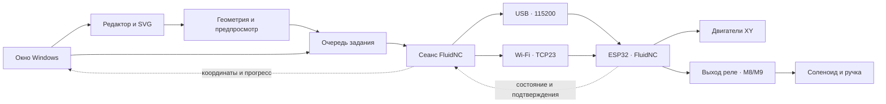

# Архитектура

Neiroslopper — компьютерный пульт. Шаговые импульсы и выполнение принятых команд остаются задачей FluidNC на ESP32.

## Окно и редактирование

app.py связывает элементы интерфейса с действиями пользователя. editor_tools и geometry.py формируют линии и преобразования. Редактор может работать без подключения: начальный A4 — размер эскиза, а не установка физического нуля.

Рисунок становится заданием только после отдельного запуска. На реальном станке нужны два сохранённых угла листа и готовый аппаратный профиль.

## Очередь и сеанс

Controller владеет единственным рабочим потоком отправки. GrblSession разбирает ответы, ждёт подтверждения команд и использует состояние Idle для проверки завершения. Ответ `ok` на движение означает приём в очередь, а не обязательно окончание перемещения.

Координаты поддерживают MPos/WCO и G54. Перезапуск контроллера инвалидирует сеанс и калибровку. Ошибки/неполная передача не приводят к автоматическому повтору движения.

## Транспорт

network_transport.py предоставляет USB и локальный TCP. При открытии USB для MKS DTR/RTS заранее выключены. Диагностическое закрытие сеанса не отправляет reset. Явный СТОП использует программный сброс.

Один и тот же пульт не должен параллельно управляться другим отправителем команд. При разрыве Wi-Fi компьютер не может гарантировать доставку СТОП; уже принятые платой команды могут продолжить выполнение.

## Конфигурация

machine_profiles.py читает фактический YAML и отделяет подключение от готовности к движению. Для профиля DLC32 проверяются физические XY/I2S, параметры осей, пины и конфликты, дополнительные активные оси и автоматические макросы. Название конфигурации само по себе не доказывает правильную проводку.

fluidnc_setup.py создаёт проект YAML. Экспорт — локальная запись файла, без загрузки в ESP32. Численные параметры и GPIO реле должны соответствовать реальной установке. Текущий мастер предусматривает вариант без концевиков и необязательный второй мотор X через канал Z.

## Подъём ручки

M8 включает питание катушки, M9 выключает. Текущий механизм поднимает ручку при включении. Полярность GPIO и направление механизма — разные свойства. Штатная FluidNC не получает от этого приложения аппаратный таймер или датчик температуры соленоида.

## Дополнительные модули

Камера и обработка растров устанавливаются отдельно. Старый сетевой DWIN-мост относится к специальной прошивке и не является условием обычного USB/Wi-Fi-подключения официальной FluidNC.
