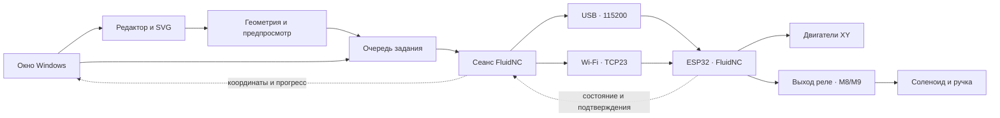

# Архитектура

Neiroslopper — компьютерный пульт. Шаговые импульсы и выполнение принятых команд остаются задачей FluidNC на ESP32.

## Окно и редактирование

app.py связывает элементы интерфейса с действиями пользователя. editor_tools и geometry.py формируют линии и преобразования. Редактор может работать без подключения: начальный A4 — размер эскиза, а не установка физического нуля.

Рисунок становится заданием только после отдельного запуска. На реальном станке нужны два сохранённых угла листа и готовый аппаратный профиль.

`assistant_ui.py` связывает диалог с выбранными объектами, вариантами и общими шаблонами. `assistant_studio.py` хранит независимый пробный лист с метаданными и своей историей. Ответы worker передаются через очередь с токеном запроса; применение проверяет текущую ревизию выбранного листа. Поздний ответ после смены цели, отмены или закрытия не применяется.

`assistant/reference_ui.py` управляет образцами; `reference_workflow.py` готовит три локальные обводки и ограниченную модельную проверку. Отправка изображений подтверждается отдельно, результат проходит ту же цепочку предпросмотра и применения. OpenCV/Pillow остаются необязательными для основного окна. Действия помощника не вызывают очередь движения.

## Очередь и сеанс

Controller владеет единственным рабочим потоком отправки. GrblSession разбирает ответы, ждёт подтверждения команд и использует состояние Idle для проверки завершения. Ответ `ok` на движение означает приём в очередь, а не обязательно окончание перемещения.

Координаты поддерживают MPos/WCO и G54. Перезапуск контроллера инвалидирует сеанс и калибровку. Ошибки/неполная передача не приводят к автоматическому повтору движения.

## Транспорт

network_transport.py предоставляет USB и локальный TCP. При открытии USB для MKS DTR/RTS заранее выключены. Диагностическое закрытие сеанса не отправляет reset. Явный СТОП использует программный сброс.

В0.8.0 подключение через общий роутер соответствует схеме товарища: TCP-сеанс MKS и отдельный HTTP/MJPEG-клиент камеры. Поиск остаётся явным действием. `wifi_address.py` даёт необязательный выбор локального адреса, без соединения при вводе. После проверки FluidNC `network_config.py` читает YAML фиксированным HTTP GET от подтверждённого числового IP TCP-сеанса; при недоступности HTTP используется строгое консольное чтение. Переадресация, публичный адрес, неполный/слишком большой ответ не принимаются. Готовность проверяет прежний валидатор YAML.

JD-маркеры времени работы/причины перезапуска — только диагностика; они не подтверждают конфигурацию и не меняют готовность к движению. Краткие числовые поля попадают в журнал, свободное содержимое HTTP-ответов в него не записывается.

Один и тот же пульт не должен параллельно управляться другим отправителем команд. При разрыве Wi-Fi компьютер не может гарантировать доставку СТОП; уже принятые платой команды могут продолжить выполнение.

## Конфигурация

machine_profiles.py читает фактический YAML и отделяет подключение от готовности к движению. Для профиля DLC32 проверяются физические XY/I2S, параметры осей, пины и конфликты, дополнительные активные оси и автоматические макросы. Название конфигурации само по себе не доказывает правильную проводку.

fluidnc_setup.py создаёт проект YAML. Экспорт — локальная запись файла, без загрузки в ESP32. Численные параметры и GPIO реле должны соответствовать реальной установке. Текущий мастер предусматривает вариант без концевиков и необязательный второй мотор X через канал Z.

## Подъём ручки

M8 включает питание катушки, M9 выключает. Текущий механизм поднимает ручку при включении. Полярность GPIO и направление механизма — разные свойства. Штатная FluidNC не получает от этого приложения аппаратный таймер или датчик температуры соленоида.

## Дополнительные модули

Камера и обработка растров устанавливаются отдельно. Старый сетевой DWIN-мост сохранён. Native DWIN/JD-DGUS2.1 требует строго распознанной совместимой прошивки, подтверждённого peer и отдельного канала управления панелью. Он не является условием обычного USB/Wi-Fi-подключения официальной FluidNC. Подробности совместимости — в [описании Native DWIN](dwin-native.md).

## Приложение UI6

`assistant/vector_drawing.py` адаптирует веб-поиск в ограниченный SVG path-план с источниками. `geometry.load_svg_bytes` проверяет его в координатах бумаги без скрытого растягивания. Полный SVG/XML/скрипты от модели не исполняются. `assistant/saved_chat.py` хранит явно выбранный UUID; `cloud_backend.resume_command` использует read-only и отключённые инструменты, остальные каналы остаются изолированными.

`board_discovery.py` и `wifi_reconnect.py` ищут сменившую IP плату только после включения «Автосвязи». Сервис получает только очередь и данные; GUI сверяет токен. MAC проверяется и при обнаружении, и перед чтением конфигурации нового сеанса. Возобновления задания нет.
